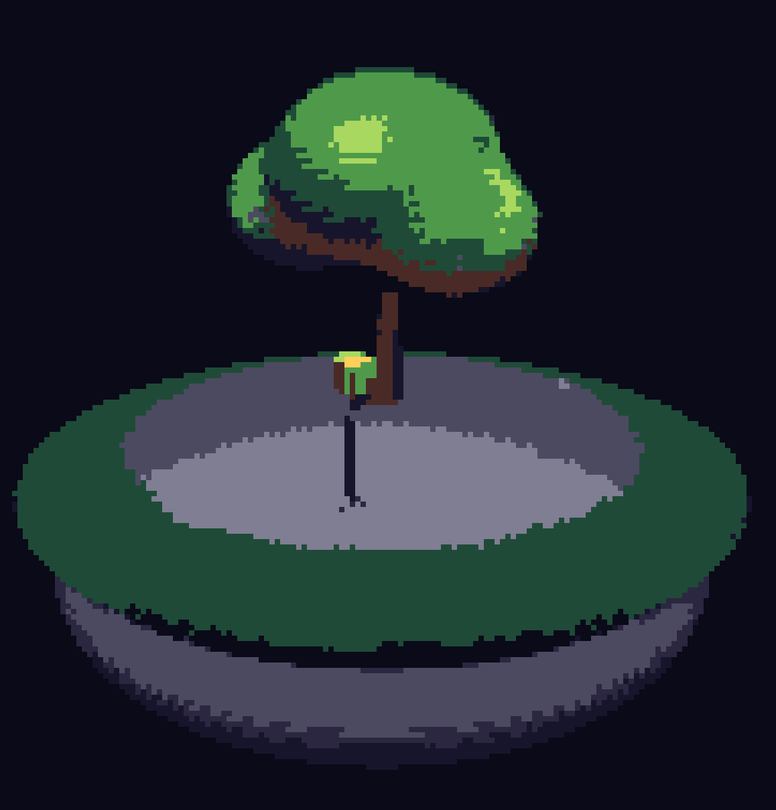

# Gaussian splatting pixel art

<p align="center">
  <a href="assets/demo.png">
    
  </a>
</p>


## Install Odin

```bash
git clone https://github.com/odin-lang/Odin  && cd Odin/

git checkout dev-2026-11a 

git lfs pull

LLVM_CONFIG=/opt/homebrew/opt/llvm/bin/llvm-config make release-native 

echo 'export PATH="/Users/macbas/odin/Odin:$PATH"' >> ~/.zshrc

source ~/.zshrc

odin version ➜ dev-2026-11:9a6991685
```